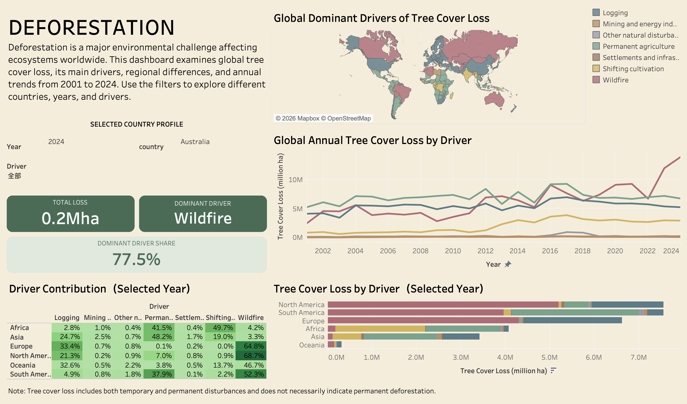

# 🌍 Global Deforestation Analysis | Tableau Dashboard

## 📌 Project Overview

Deforestation is a major global environmental challenge,
affecting biodiversity, climate change, and sustainable
development.

This project uses Tableau to explore global deforestation
patterns, compare the dominant drivers of forest loss
across countries and regions, and communicate insights
through an interactive dashboard.

### Project Objectives

- Identify geographical patterns of deforestation.
- Compare major deforestation drivers across regions.
- Explore differences between countries.
- Develop an interactive dashboard for data exploration.
- Translate complex data into actionable insights.

---

## 🛠 Tools & Technologies

- **Tableau:** Interactive dashboards and visualization
- **Excel / CSV:** Data preparation and exploration
- **Data Analysis:** Comparative and exploratory analysis
- **Data Visualization:** Maps, Treemaps and Charts

---

## 📊 Dataset

**Dataset:** Tree Cover Loss by Dominant Driver

**File:** `tree-cover-loss-by-dominant-driver.csv`

The dataset is used to investigate the geographical
distribution of tree cover loss and its associated drivers.

The analysis focuses on:
- Country-level comparisons
- Regional differences
- Categories of deforestation drivers
- Patterns in tree cover loss

---

## 🔍 Methodology

### 1. Data Preparation

- Imported the CSV dataset into Tableau.
- Reviewed data types and geographical fields.
- Checked for missing or inconsistent location names.
- Prepared relevant dimensions and measures.
- Organized the dataset for comparative visualization.

### 2. Exploratory Data Analysis

Explored deforestation patterns across countries and
regions, focusing on the contribution of different
drivers to tree cover loss.

### 3. Dashboard Development

Developed an interactive Tableau dashboard featuring:

**World Map**
- Displays the geographical distribution of forest loss.
- Allows country-level comparisons.

**Treemap**
- Compares deforestation drivers.
- Highlights the relative contribution of each category.

**Comparative Charts**
- Explore differences across geographical regions.
- Support comparisons between countries and drivers.

**Interactive Filters**
- Enable users to explore selected countries or categories.
- Support more detailed investigation of patterns.

---

## 🖥 Dashboard Preview

*Figure 1. Interactive Tableau dashboard for global
deforestation analysis.*

---

## 💡 Key Insights

### 1. Wildfire Has Become a Major Driver of Tree Cover Loss
- Global tree cover loss associated with wildfire increased sharply toward 2024, reaching the highest level shown in the 2001–2024 trend chart.
- Wildfire accounted for **68.7% of tree cover loss in North America** and **64.8% in Europe** in 2024, highlighting its significant regional impact.

### 2. Deforestation Drivers Vary Significantly Across Regions
- In **Africa**, shifting cultivation (49.7%) and permanent agriculture (41.5%) were the leading drivers of tree cover loss in 2024.
- In **Asia**, permanent agriculture accounted for 48.2%, followed by logging at 24.7%.
- These differences suggest that forest management strategies should be adapted to regional drivers rather than applying a single global approach.

### 3. South America Faces Multiple Sources of Forest Loss
- In 2024, wildfire contributed **52.3%** of tree cover loss in South America, followed by permanent agriculture at **37.9%**.
- This highlights the importance of addressing both fire-related disturbances and agricultural land-use pressures.

### 4. Tree Cover Loss Is Unevenly Distributed Geographically
- The regional comparison shows that North America and South America recorded some of the largest total tree cover losses in 2024, each approximately **7.5 million hectares**.
- Interactive geographical visualizations enable users to compare the scale and composition of tree cover loss across regions.

### 5. Country-Level Analysis Reveals More Specific Patterns
- Australia recorded approximately **0.2 million hectares** of tree cover loss in 2024.
- Wildfire was its dominant driver, contributing **77.5%** of the country's total tree cover loss.
- Country-specific filters and KPI indicators help connect broader global trends with local environmental conditions.

**Important Note:** Tree cover loss includes both temporary and permanent disturbances. Therefore, it should not be interpreted as equivalent to permanent deforestation.

---

## 📁 Repository Structure

Global-Deforestation-Dashboard/
|
|-- README.md
|-- Global-Deforestation-Dashboard.twbx
|-- tree-cover-loss-by-dominant-driver.csv
|
`-- images/
    `-- dashboard-preview.png

---

## 🚀 How to Use

1. Download the `.twbx` file from this repository.
2. Open it using Tableau Desktop.
3. Navigate to the dashboard.
4. Explore geographical patterns and deforestation drivers.
5. Use interactive filters to investigate specific areas.

---

## 🎯 Project Outcomes

This project demonstrates practical experience in:

- Data preparation and exploratory analysis
- Interactive dashboard design
- Geographical data visualization
- Comparative analysis
- Data storytelling and insight communication

---

## 👤 Author

**Zhou Dianfeng**

Business Analytics Student

Interested in Data Analytics, AI, Machine Learning
and Product Management.

**LinkedIn:**
https://www.linkedin.com/in/dianfeng-zhou-71a64402

